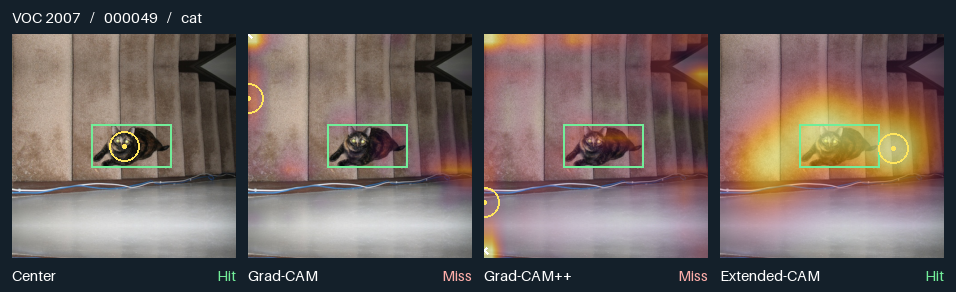
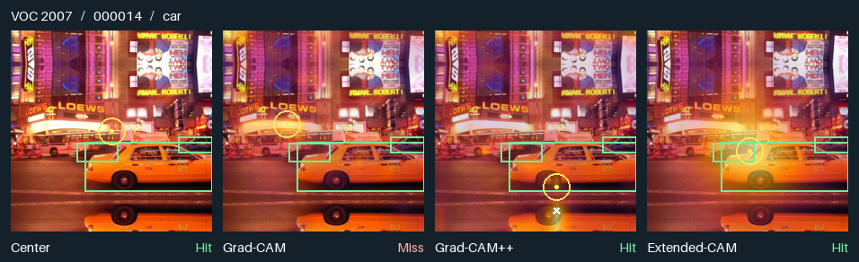
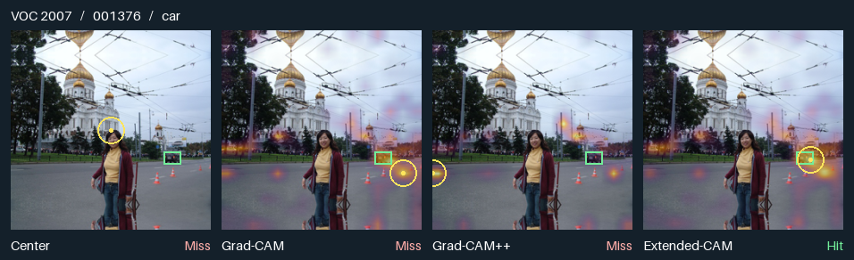

# Extended-CAM Pointing Game

Official PyTorch code for the PASCAL VOC 2007 pointing game from the Extended-CAM paper. Compare Center, Grad-CAM, Grad-CAM++, and Extended-CAM on ResNets and timm models. [Paper](https://doi.org/10.1016/j.cviu.2023.103663)

[Quick start](#quick-start) · [Checkpoints](#use-the-original-checkpoints) · [Scoring](#pointing-game-protocol) · [Table 4 results](#table-4-results) · [ViT and timm](#vit-and-timm-models) · [Examples](#pointing-game-examples) · [Citation](#citation)

## Quick start

Use Python 3.10 or later. For GPU runs, install the PyTorch and torchvision wheels for your CUDA driver first. [PyTorch installation](https://pytorch.org/get-started/locally/)

```bash
python -m pip install -e .
```

Extract the VOC 2007 test archive under `data/`. [VOC 2007 downloads](https://www.robots.ox.ac.uk/~vgg/projects/pascal/VOC/voc2007/)

```bash
mkdir -p data
tar -xf VOCtest_06-Nov-2007.tar -C data
```

Run Center first. It uses the test annotations alone.

```bash
voc=data/VOCdevkit/VOC2007
cam-pointing-game evaluate --voc-root "$voc" --method center
```

### Use the original checkpoints

Save the archive (1.30 GiB) in the repository root. It contains all six original Table 4 checkpoints. [Download `table4-checkpoints.tar`](https://github.com/kmbmjn/cam_pointing_game/releases/download/v0.1.0/table4-checkpoints.tar)

```bash
tar -xf table4-checkpoints.tar
(cd checkpoints && sha256sum -c ../checkpoints.sha256)
cam-pointing-game evaluate --voc-root "$voc" --model resnet18 \
  --checkpoint checkpoints/resnet18.pth --output runs/resnet18-table4.json
```

This compares all four methods on the test split. The evaluator uses the published σ for these weights.

### Train your own checkpoint

Extract the VOC 2007 train/validation archive into the same `data/` directory.

```bash
tar -xf VOCtrainval_06-Nov-2007.tar -C data
cam-pointing-game train --voc-root "$voc" --model resnet18 --output runs/resnet18.pth
cam-pointing-game evaluate --voc-root "$voc" --model resnet18 \
  --checkpoint runs/resnet18.pth --output runs/resnet18.json
```

`train` fine-tunes an ImageNet model on VOC `train` and saves the epoch with the lowest binary cross-entropy (BCE) on VOC `val`. ResNet-18 trains for 200 epochs by default. Use the BCE values below as a training reference, then run the pointing game to measure localization.

`evaluate` fits Extended-CAM's Gaussian width (σ) on VOC `val` for a new checkpoint. For a quick check, add `--limit 32 --erf-limit 32`.

### One-line CAMs

Pass an evaluation-mode model, an RGB tensor of shape `(N, 3, H, W)` with values in `[0, 255]`, and the class ID. This example uses the original ResNet-18 checkpoint and fits σ on VOC `val`. Extract the train/validation archive as shown above.

```python
from pathlib import Path

import torch

from cam_pointing_game import extended_cam, grad_cam, grad_cam_pp
from cam_pointing_game.models import load_model
from cam_pointing_game.voc import CLASS_INDEX, VOCImages, make_loader, read_annotation, read_annotations

voc = Path("data/VOCdevkit/VOC2007")
device = torch.device("cuda" if torch.cuda.is_available() else "cpu")
model = load_model("resnet18", Path("checkpoints/resnet18.pth"), device)
cat_image = read_annotation(voc / "Annotations/000049.xml")
image, _ = VOCImages(voc, [cat_image])[0]
images = image.unsqueeze(0)
cat = CLASS_INDEX["cat"]
calibration = make_loader(voc, read_annotations(voc, "val"), batch_size=8, workers=0, device=device)

gradcam = grad_cam(model, images, cat)
gradcampp = grad_cam_pp(model, images, cat, formula="archive")
extended, erf = extended_cam(model, images, cat, calibration=calibration)
```

Extended-CAM returns the maps and the fitted receptive field. Reuse `erf["sigma"]` as `sigma=erf["sigma"]` when explaining more images with the same model and input size.

## Pointing-game protocol

1. Mirror-pad the image and resize it. Move the bounding boxes with the image.
2. Make one CAM per annotated class and take its brightest point. Reflect a point in the padding across the image edge. Center always chooses the middle of the image.
3. On the 224 × 224 scoring grid, draw a circle of radius 15 pixels around the point. It is a hit if the circle touches any box for the chosen class.
4. Calculate the hit rate for each class and average the class scores.

For **Difficult**, the image must contain at least two classes. On the scoring grid, the sum of the box areas must be less than a quarter of the unpadded image area. Table 4 sums all boxes. Use `--difficult-set target-boxes` for the target-class rule in the paper and `--box-source object` for direct VOC object boxes.

The Excitation Backprop paper describes a tolerance margin. Its COCO code checks for circle overlap, and Jianming Zhang confirmed by email that the same rule applies to VOC boxes. Center scored **74.07% / 44.33%** (All / Difficult) in our run. The original paper reports **69.5% / 42.6%**. [Excitation Backprop paper](https://doi.org/10.1007/s11263-017-1059-x) · [COCO evaluator](https://github.com/jimmie33/Caffe-ExcitationBP/blob/master/excitationBP/eval_coco.py#L80-L136)

## Table 4 results

We reran the six original checkpoints on all 4,952 VOC 2007 test images. Extended-CAM leads on both subsets for every model. Scores are **All / Difficult** percentages.

| Model (`--model`) | Validation BCE | Grad-CAM | Grad-CAM++ | Extended-CAM |
| --- | ---: | ---: | ---: | ---: |
| `resnet18` | 0.100434 | 68.87 / 50.64 | 39.56 / 18.72 | **82.81 / 64.13** |
| `resnet50` | 0.081077 | 74.17 / 55.57 | 46.43 / 23.95 | **88.63 / 69.60** |
| `resnet101` | 0.079427 | 83.79 / 63.29 | 54.26 / 31.87 | **88.54 / 72.10** |
| `wide_resnet101_2` | 0.078579 | 71.35 / 49.12 | 59.22 / 34.11 | **88.57 / 70.36** |
| `resnet152` | 0.075767 | 86.31 / 65.11 | 68.40 / 46.97 | **89.32 / 71.31** |
| `resnext101_32x8d` | 0.072140 | 77.93 / 60.82 | 36.15 / 18.66 | **90.83 / 75.53** |

Grad-CAM and Extended-CAM are within 0.02 and 0.06 percentage points of the paper, respectively. The largest difference for the archived Grad-CAM++ formula is 4.09 points on WideResNet-101-2 Difficult. The full reports include per-class counts, validation losses, and ERF fits. [Paper](https://doi.org/10.1016/j.cviu.2023.103663) · [Table 4 reports](results/table4/)

## ViT and timm models

At a ResNet layer, features already sit on a 2D grid. In a standard ViT, each image patch has its own token. The adapter puts the patch activations and gradients back on a grid. It skips extra tokens such as the class token `[CLS]` and register tokens. For example, a 256 × 256 image with 16 × 16 patches gives a 16 × 16 grid.

If the classifier reads only `[CLS]`, the final patch outputs have zero gradient for the class score. The adapter uses the second-to-last block so the last attention block can still mix patch information into `[CLS]`. Models that pool patch tokens can use the final block. Use `--target-layer` to pick a layer, such as `norm` for the SigLIP 2 run below. [ViT paper](https://arxiv.org/abs/2010.11929) · [timm adapter](cam_pointing_game/timm_adapter.py)

The adapter uses each timm model's input size, interpolation, and RGB normalization. It finds the CAM peak at that size and maps the point to the same 224 × 224 scoring grid. [timm data configuration](https://huggingface.co/docs/timm/main/reference/data)

```bash
python -m pip install -e '.[timm]' timm==1.0.31
voc=data/VOCdevkit/VOC2007
model=timm:vit_dpwee_patch16_reg1_gap_256.sbb_nadamuon_in1k
cam-pointing-game train --voc-root "$voc" --model "$model" --epochs 8 --output runs/dpwee.pth
cam-pointing-game evaluate --voc-root "$voc" --model "$model" \
  --checkpoint runs/dpwee.pth --output runs/dpwee.json
```

These runs show where Extended-CAM led on both subsets. Scores are All / Difficult percentages. Each run uses one training seed and Grad-CAM++ Eq. (19). [All timm reports](results/timm/) · [Other backbone reports](results/backbones/)

| Model | Input | Grad-CAM | Grad-CAM++ | Extended-CAM |
| --- | ---: | ---: | ---: | ---: |
| [RoPE ViT-S/16](results/timm/vit_small_patch16_rope_224.naver_in1k.json) | 224 × 224 | 61.65 / 43.07 | 35.99 / 14.02 | **76.17 / 57.67** |
| [Swin V2 Tiny](results/timm/swinv2_tiny_window8_256.ms_in1k.json) | 256 × 256 | 76.64 / 61.14 | 66.72 / 39.00 | **84.57 / 73.98** |
| [SigLIP 2 ViT-B/16](results/timm/vit_base_patch16_siglip_256.v2_webli.json) | 256 × 256 | 83.60 / 62.70 | 72.09 / 43.29 | **86.53 / 71.48** |
| [DeiT III Small/16](results/timm/deit3_small_patch16_384.fb_in22k_ft_in1k.json) | 384 × 384 | 62.42 / 43.64 | 39.79 / 20.54 | **77.54 / 68.06** |
| [ViT-Dpwee/16](results/timm/vit_dpwee_patch16_reg1_gap_256.sbb_nadamuon_in1k.json) | 256 × 256 | 70.02 / 41.60 | 67.75 / 42.92 | **75.04 / 47.55** |
| [EfficientViT-B1](results/timm/efficientvit_b1.r256_in1k.json) | 256 × 256 | 63.62 / 37.96 | 61.52 / 37.67 | **86.89 / 73.63** |

## Pointing-game examples

Green boxes mark the chosen class. The yellow circle is used for scoring. A white × shows the original point before reflection.



**Cat, VOC `000049`.** The Extended-CAM point lands just outside the box, and its circle still scores a hit.



**Car, VOC `000014`.** Grad-CAM++ points into the mirror padding. Its reflected point hits a car box.



**Car, VOC `001376`.** ViT-Dpwee's Extended-CAM points to the distant car on the right.

Draw the cat example with the original ResNet-18 checkpoint.

```bash
cam-pointing-game visualize --voc-root "$voc" --model resnet18 \
  --checkpoint checkpoints/resnet18.pth --image-id 000049 --category cat --output runs/cat.png
```

## Citation

[Extended-CAM](https://doi.org/10.1016/j.cviu.2023.103663) · [Dead pixel test using effective receptive field](https://doi.org/10.1016/j.patrec.2023.02.018) · [Citation file](CITATION.cff)

```bibtex
@article{kim2023extendedcam,
  title   = {Extending class activation mapping using {Gaussian} receptive field},
  author  = {Kim, Bum Jun and Koo, Gyogwon and Choi, Hyeyeon and Kim, Sang Woo},
  journal = {Computer Vision and Image Understanding},
  volume  = {231},
  pages   = {103663},
  year    = {2023},
  doi     = {10.1016/j.cviu.2023.103663}
}

@article{kim2023deadpixel,
  title   = {Dead pixel test using effective receptive field},
  author  = {Kim, Bum Jun and Choi, Hyeyeon and Jang, Hyeonah and Lee, Dong Gu and Jeong, Wonseok and Kim, Sang Woo},
  journal = {Pattern Recognition Letters},
  volume  = {167},
  pages   = {149--156},
  year    = {2023},
  doi     = {10.1016/j.patrec.2023.02.018}
}
```
